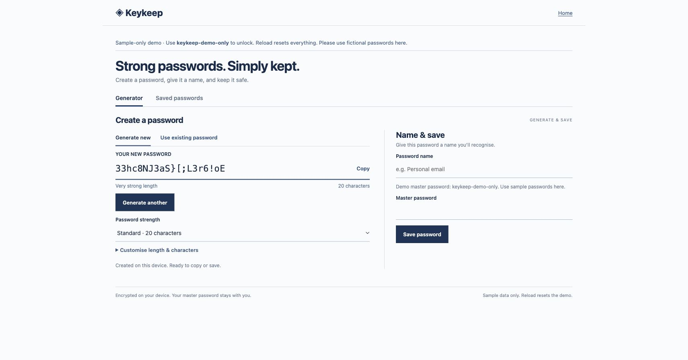

# Keykeep

A small, self-hostable encrypted password vault with optional cloud sync.

Generate a password, give it a name, and keep it behind a master password. Keykeep uses a compact, flat interface and browser-side encryption. You can run it locally without an account or host an approval-based service with Cloudflare Pages, D1 and OIDC sign-in.

**Experimental beta · MIT licensed · No independent security audit.** Use fictional credentials when evaluating it. See the [threat model](docs/THREAT_MODEL.md) before trusting it with sensitive credentials.

[Try the sample demo](https://keykeep-demo.pages.dev) · [Cloud hosting](CLOUD_HOSTING.md) · [Contribute](CONTRIBUTING.md) · [Report a vulnerability privately](https://github.com/exponentialR/keykeep/security/advisories/new)

The public demo has three fictional entries. Unlock with `keykeep-demo-only`. Its vault stays in memory, has no cloud connection and resets on reload.



## Run locally

Install Node.js 24 or newer, then:

```sh
git clone https://github.com/exponentialR/keykeep.git
cd keykeep
npm ci
npm start
```

Open **http://127.0.0.1:4173**. Keep using that same address and browser profile for your local vault. The development server binds to loopback; do not expose it publicly.

For the sample-only demo, run `npm run demo` and open **http://127.0.0.1:4173/demo**. If another Keykeep server is running, use `KEYKEEP_PORT=4178 npm run demo` and open port 4178 instead.

## What it does

- Generate passwords with length and character presets, or save an existing one.
- Save named entries with optional usernames, creation dates and updated dates.
- Show names while locked; unlock to copy, edit or view passwords.
- Keep encrypted revision history and recover deleted entries.
- Export and restore encrypted backups; change the master password.
- Lock manually, after inactivity or when another tab changes the vault.
- Optionally sync encrypted copies across PCs signed into the same approved account.
- Compare conflicting copies, keep disjoint changes, choose between competing edits and preserve both encrypted originals.
- Run a hosted approval process with isolated member vaults and optional approval emails.

## Security and recovery

Passwords, usernames, history and deleted entries are encrypted together with AES-256-GCM. PBKDF2-SHA-256 derives the key from your master password using a random salt and 600,000 iterations. Each write uses a fresh random IV. The master password is not stored or sent to the vault API.

**Names and dates are visible while locked** and are included in the unencrypted display index of local storage and backups. The cloud API strips that index. Do not put sensitive information in entry names.

There is **no forgotten-master-password recovery**. Keep your master password safe and download encrypted backups. Clearing browser data removes local copies and unsynced changes. Old backups and retained server versions still need their original master password after a password change.

Unlocked passwords are visible in memory and on screen. A compromised browser, extension, device or hosting account can undermine the protection. A hosting operator can change the JavaScript delivered to users, even though the ordinary admin interface cannot decrypt member vaults. Read the [threat model](docs/THREAT_MODEL.md), [security policy](SECURITY.md) and [verification record](docs/VERIFICATION.md).

## Cloud hosting and offline use

Cloud hosting needs a Pages project, D1 database, OIDC provider and HTTPS origin. Resend approval emails are optional. [Follow the hosting guide](CLOUD_HOSTING.md); the committed configuration contains placeholders, not a working private deployment.

Each member has a separate vault. Explicitly configured owner aliases can share the owner's vault. Server admission and account-scoped browser storage prevent ordinary cross-account access.

Opening the hosted app requires online sign-in and approval. An already-open app can save locally while offline; changes remain pending until sync succeeds. Reopening the hosted app offline is unsupported. Browser installation support varies. Local mode needs its local server running.

## Development

```sh
npm test
npm audit --omit=dev
npm run build:demo
npm run build:cloud
```

Checks cover application lifecycle, encryption, recovery, account separation, Worker admission, sync, conflict resolution and email retries. Simulated clients are used for automated cloud tests; they are not a real multi-PC sign-in trial or an independent audit.

See [contribution guidance](CONTRIBUTING.md), [known verification limits](docs/VERIFICATION.md) and the [release plan](RELEASE_PLAN.md). A short [sample walkthrough](docs/assets/walkthrough.mp4) is included. Community launch copy is available as [unsent drafts](docs/LAUNCH_DRAFTS.md).

## Save logins from websites

The experimental Chrome/Edge extension lets you read a filled login when you click the toolbar, review it in Keykeep and explicitly save or update it in your encrypted vault. See [installation and usage](docs/BROWSER_EXTENSION.md). Build it with `npm run build:extension`; load `.build/keykeep-extension` as an unpacked extension.
